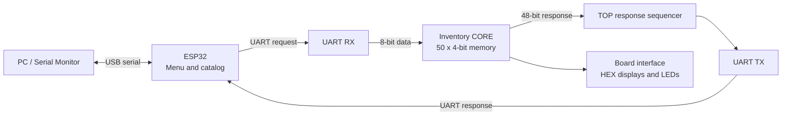
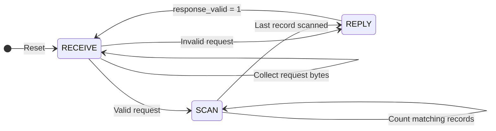
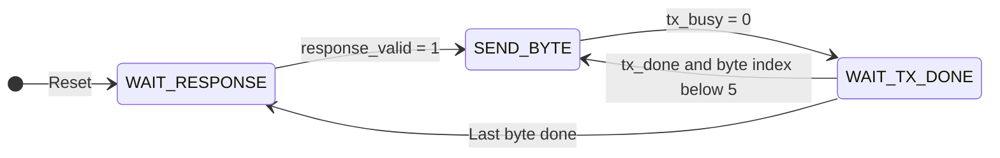

<div align="center">

# HospitalTrack V2

### Intelligent Medical Equipment Tracking System

**FPGA-based inventory management · Embedded systems · Hardware/software integration**

`Verilog HDL` · `Intel MAX 10` · `Terasic DE10-Lite` · `ESP32` · `UART` · `Active-HDL`

**Universidad de las Américas Puebla (UDLAP)**  
Embedded Systems Laboratory · Final Project · 2026

[Overview](#project-overview) · [Architecture](#system-architecture) · [Memory](#fpga-memory) · [Protocol](#uart-protocol) · [Validation](#experimental-validation) · [Setup](#installation-and-operation) · [Downloads](#project-downloads)

</div>

---

| **50** equipment records | **8** hospital zones | **200 bits** location memory | **50 MHz** FPGA clock |
| :---: | :---: | :---: | :---: |
| 6 seven-segment displays | 10 LEDs | 115200 baud | 5 Verilog modules |

## Project overview

HospitalTrack V2 is an embedded system designed to register, locate and transfer medical equipment between hospital departments. It addresses the need for an accurate, centralized record of equipment locations in a shared clinical environment.

The system combines an **ESP32 development board** with a **Terasic DE10-Lite FPGA**. The ESP32 provides a human-readable serial interface, while the FPGA stores the equipment locations, validates commands, updates records, calculates zone totals and drives physical indicators. The FPGA is therefore the authoritative inventory controller, not simply a display peripheral.

### Key capabilities

- Register and relocate any of 50 medical equipment records across eight hospital zones.
- Retrieve equipment locations, browse a paginated inventory and search the catalog.
- List equipment by department and calculate hospital-wide totals.
- Validate incoming binary requests and reject invalid operations without modifying inventory.
- Display equipment ID, zone, count and operation status directly on the FPGA board.
- Clear all stored locations through the hardware reset button.

> **Project scope:** This is a laboratory implementation of manually registered equipment movements. It does not automatically detect physical movement or use RFID, GPS or a hospital network.

## System architecture



| Component | Responsibility |
| --- | --- |
| PC | User commands and human-readable results. |
| ESP32 | Menu, equipment names, frame encoding and response validation. |
| FPGA | Inventory memory, command validation, location updates and counting. |
| Physical outputs | Equipment ID, zone, count and operation status. |

### FPGA design modules

| Source file | Function |
| --- | --- |
| `uart_rx.v` | Receives serial bits, reconstructs bytes and pulses `valid`. |
| `uart_tx.v` | Transmits bytes using UART 8N1 framing; provides `busy` and `done`. |
| `hospitaltrack_core.v` | Implements the inventory, command parser, validation, counting and response generation. |
| `hospitaltrack_top.v` | Integrates RX, CORE and TX; sequences six response bytes. |
| `HospitalTrack_DE10_Lite.v` | Board-level top entity, clock, reset, LED mapping and seven-segment decoding. |
| `HospitalTrack_ESP32.ino` | Serial user interface, catalog and UART gateway firmware. |

[Download all source files](Hospital_track_codigos.zip) · [Download system, wiring, FPGA block and memory diagrams](HospitalTrack_Diagrams_System.zip)

## Hardware implementation

| ESP32 | DE10-Lite JP1 | FPGA pin | Direction |
| --- | --- | --- | --- |
| GPIO17 / TX2 | GPIO0, physical pin 1 | `PIN_V10` | ESP32 → FPGA |
| GPIO16 / RX2 | GPIO1, physical pin 2 | `PIN_W10` | FPGA → ESP32 |
| GND | GND, physical pin 12 | — | Common reference |

The design uses the onboard 50 MHz clock (`PIN_P11`) and active-low manual reset `KEY[0]` (`PIN_B8`). Full pin assignments are included in the source package as `Pin_Planner.qsf` and `Pin_Planner.csv`.

> [!IMPORTANT]
> Use 3.3 V UART logic, cross TX and RX, and connect a common ground. Power both boards through their respective USB connections. Never connect 5 V to a UART input. The table describes the intended wiring; the photographs do not independently establish every electrical connection.

## FPGA memory

The inventory is implemented as an array of 50 four-bit registers in Verilog:

```verilog
reg [3:0] inventory [0:49];
```

Each record stores one zone code. Equipment ID `n` maps to address `n - 1`. Four bits represent the nine possible location states (00–08).

**50 records × 4 bits = 200 bits = 25 bytes of logical location storage.**

| Address (decimal) | Equipment ID | Example stored value | Meaning |
| :---: | :---: | :---: | --- |
| 0 | 01 | `0000` | Unregistered |
| 1 | 02 | `0100` | Intensive care |
| 6 | 07 | `0010` | Emergency |
| … | … | … | … |
| 49 | 50 | `1000` | Outpatient consultation |

*Illustrative memory contents, not a captured inventory snapshot.*

| Zone | Department | Indicator |
| :---: | --- | --- |
| 00 | Unregistered | No zone LED |
| 01 | Storage | LEDR0 |
| 02 | Emergency | LEDR1 |
| 03 | Operating room | LEDR2 |
| 04 | Intensive care (ICU) | LEDR3 |
| 05 | Inpatient care | LEDR4 |
| 06 | Imaging | LEDR5 |
| 07 | Laboratory | LEDR6 |
| 08 | Outpatient consultation | LEDR7 |

### Memory operations

- **Write:** a valid MOVE request updates only the addressed record.
- **Read:** QUERY retrieves the stored zone without changing it.
- **Overwrite:** a new MOVE replaces the previous location, rather than creating a duplicate.
- **Count:** the CORE scans one record per clock cycle. A 50-entry scan takes 50 cycles (1 µs at 50 MHz), excluding UART and response overhead.
- **Reset:** all records return to zone 00. The memory is volatile.

The 200-bit figure describes logical storage, not total FPGA resource utilization. Dedicated M9K RAM inference is not claimed.

## Finite state machines

### Inventory CORE



The CORE receives and validates the five-byte request, writes memory only for an accepted MOVE, scans the inventory and returns the result. Invalid requests bypass the scan and do not write to memory.

### Response sequencer



| Controller | State sequence |
| --- | --- |
| UART RX | `S_IDLE → S_START → S_DATA → S_STOP` |
| UART TX | `S_IDLE → S_START → S_DATA → S_STOP` |
| CORE | `RECEIVE → SCAN → REPLY` |
| TOP | `WAIT_RESPONSE → SEND_BYTE → WAIT_TX_DONE` |
| Board reset | `00 → 01 → 11` |

The board reset sequence is an equivalent representation of the two-bit reset synchronizer, not an explicitly declared FSM. The repository root also contains the individual state-machine images.

## UART protocol

| Parameter | Specification |
| --- | --- |
| Baud rate | 115200 bps |
| Format | 8N1; LSB first within each byte |
| FPGA bit timing | 434 clock cycles, approximately 8.68 µs |
| Request length | 5 bytes |
| Response length | 6 bytes |
| Integrity check | Bytewise XOR |
| Timeouts | 20 ms partial-request gap; 700 ms ESP32 response timeout |

```text
REQUEST   [ A5 | ID | ZONE | COMMAND | XOR ]
RESPONSE  [ 5A | ID | ZONE | STATUS  | COUNT | XOR ]
```

The XOR checksum covers every preceding byte of its frame. It detects some transmission errors but is not a security mechanism.

| Command (hex) | Operation | ID (decimal) | Zone (decimal) |
| :---: | --- | :---: | :---: |
| `01` | MOVE | 1–50 | 1–8 |
| `02` | QUERY | 1–50 | 0 |
| `03` | COUNT | 0 | 0–8 |
| `04` | QUIET_QUERY | 1–50 | 0 |
| `05` | QUIET_COUNT | 0 | 0–8 |

Quiet commands preserve the physical display on success while the ESP32 browses inventory.

| Status (hex) | Meaning |
| :---: | --- |
| `00` | Movement accepted |
| `01` | Query successful |
| `02` | Count successful |
| `E1` | Invalid equipment ID |
| `E2` | Invalid zone |
| `E3` | Invalid command |
| `E4` | Invalid checksum |

### Example transaction

Register equipment 07 in Emergency, assuming the zone is initially empty:

```text
Console command:  MOVER 07 02
MOVE request:     A5 07 02 01 A1
FPGA response:    5A 07 02 00 01 5E
Physical display: 07 02 01
```

The ESP32 also performs a quiet query to retrieve the previous location before sending the MOVE request.

## User interface and physical feedback

The Spanish-language serial console provides seven menu options: locate equipment, transfer equipment, complete inventory, equipment by zone, catalog, hospital summary and help.

| HEX5–HEX4 | HEX3–HEX2 | HEX1–HEX0 |
| :---: | :---: | :---: |
| Equipment ID | Zone | Equipment count in zone |
| **07** | **02** | **01** |

The six digits are decimal. LEDR0–LEDR7 indicate the zone, LEDR8 indicates success and LEDR9 indicates an FPGA rejection. A rejected request preserves the previous numeric display and zone indicator while updating the status LEDs.

## Experimental validation

### 1. RTL hardware structure

The Quartus RTL schematic documents the board-level logical implementation, including reset synchronization, module integration, display decoding and LED control. It is not a post-fit timing or resource report.

**[View original Quartus RTL schematic (PDF)](RTL_Hospitaltrack.pdf)**

### 2. Memory waveform validation

<div align="center">

</div>

*Original Active-HDL simulation capture of the HospitalTrack V2 inventory controller.*

The memory testbench injects bytes into the CORE and observes the actual internal inventory through hierarchical references. The `mem_we`, `mem_re`, `mem_addr`, `mem_wdata` and `mem_rdata` signals are simulation probes, not additional synthesized ports.

| Phase | Operation | Observed or checked result |
| :---: | --- | --- |
| 1 | Move equipment 02 to zone 04 | Record 02 = 4; count = 1 |
| 2 | Move equipment 50 to zone 04 | Record 50 = 4; count = 2 |
| 3 | Query equipment 02 | Zone 04; count = 2 |
| 4 | Move equipment 02 to zone 08 | Record 02 = 8; count = 1 |
| 5 | Query equipment 50 | Zone 04 retained; count = 1 |
| 6 | Corrupt MOVE checksum | `E4`; no memory write |
| 7 | Query equipment 50 again | Zone 04 retained after rejection |
| 8 | Count equipment in zone 04 | Count = 1 |
| 9 | Assert reset | All 50 records cleared |
| A (10) | Query equipment 02 | Zone 00; 50 unregistered (`0x32`) |

| **9** response checks | **3** accepted writes | **4** successful queries |
| :---: | :---: | :---: |

The supplied simulation reached completion phase `B`. The testbench checks all 50 memory entries after each scenario. A separate bit-level UART testbench is included for further integration testing; its inclusion does not establish that every test was executed.

### 3. Functional and physical validation

The original serial captures document equipment 07 (electrocardiograph) initially unregistered, a successful transfer to Emergency, and subsequent consistent inventory and zone-query results.

| Physical display | Equipment | Department | Count | Active LEDs |
| :---: | --- | --- | :---: | --- |
| `07 02 01` | Electrocardiograph | Emergency | 1 | LEDR1, LEDR8 |
| `15 01 04` | Laparoscopy instruments | Storage | 4 | LEDR0, LEDR8 |

These outputs are visible in the original hardware photographs. The serial console's final documented summary reports the following inventory state:

| Location | Records | Share of capacity |
| --- | ---: | ---: |
| Storage | 4 | 8% |
| Emergency | 1 | 2% |
| Other registered zones | 0 | 0% |
| Unregistered | 45 | 90% |
| **Total** | **50** | **100%** |

This is a demonstration snapshot, not an exhaustive physical test of all 50 IDs or a clinical deployment.

**[Download technical PDFs, photographs, serial captures and first video](Hospitaltrack_evidence_1.zip)**  
**[Download the two additional demonstration videos](Hospitaltrack_evidence_2.zip)**

## Installation and operation

### 1. FPGA — Quartus

1. Download and extract the [source package](Hospital_track_codigos.zip).
2. Create a Quartus project for the MAX 10 device on the DE10-Lite.
3. Add the five synthesizable Verilog modules and set `HospitalTrack_DE10_Lite` as the top-level entity.
4. Merge the provided `Pin_Planner.qsf` assignments into the project QSF. It is a pin-assignment fragment, not a complete Quartus project.
5. Compile and program the FPGA using the generated `.sof` and USB-Blaster.

Do not include the simulation testbenches in the synthesis file set.

### 2. ESP32 — Arduino IDE

1. Open `HospitalTrack_ESP32.ino` and install ESP32 board support.
2. Select **ESP32 Dev Module** and the actual COM port, then upload the sketch.
3. Connect the UART wiring as specified above.
4. Open Serial Monitor at **115200 baud**, with **Newline** (`Nueva línea`) selected.

### 3. Demonstration

Starting with cleared inventory, enter these commands from the main menu. Press Enter to return to the menu when prompted.

```text
CONSULTAR 07
MOVER 07 02
CONSULTAR 07
```

The initial query returns zone 00. The MOVE registers equipment 07 in Emergency. The final query returns zone 02. If no other equipment is registered there, the display reads `07 02 01` with LEDR1 and LEDR8 active. Use menu option 4 for the zone list and option 6 for the hospital summary.

### 4. Simulation — Active-HDL

Compile `hospitaltrack_core.v` and `tb_hospitaltrack_memoria.v`. Select `tb_hospitaltrack_memoria` as simulation top, initialize and add the signals shown in the waveform. Run until completion (the testbench has a 25,000 ns global timeout). Check the `ALL MEMORY CHECKS PASSED` message and counters.

For bit-level UART integration testing, compile the five RTL modules with `tb_hospitaltrack_v2.v` and select `tb_hospitaltrack_v2` as simulation top.

## Project downloads

All packages are available directly in this repository. Extract each ZIP independently.

| Resource | Contents |
| --- | --- |
| [Source code](Hospital_track_codigos.zip) | Five RTL modules, ESP32 sketch, two testbenches, QSF and CSV pin assignments. |
| [System diagrams](HospitalTrack_Diagrams_System.zip) | System architecture, wiring, FPGA block and memory diagrams in PNG/SVG. |
| [Evidence — Part 1](Hospitaltrack_evidence_1.zip) | RTL, functional and hardware evidence PDFs, original photographs, serial captures, waveform and one video. |
| [Evidence — Part 2](Hospitaltrack_evidence_2.zip) | Two additional original demonstration videos. |
| [RTL schematic](RTL_Hospitaltrack.pdf) | Original Quartus RTL export. |
| [Memory waveforms](Waveforms%20Hospital_track.jpeg) | Original Active-HDL waveform capture. |

The five individual FSM diagrams are also available in the repository root.

## Limitations and future development

HospitalTrack V2 uses manually entered movements, volatile memory and a wired serial interface. Future work could add nonvolatile storage, automatic identification, networked access, authentication and a larger inventory. These extensions are not implemented in the current version.

## Project team

| Developer | Institution |
| --- | --- |
| **Diego Garrido Jauckens** | Universidad de las Américas Puebla |
| **Sergio Emilio López Montalvo** | Universidad de las Américas Puebla |

**Course:** Embedded Systems Laboratory  
**Project:** HospitalTrack V2 — Intelligent Medical Equipment Tracking System  
**Year:** 2026

---

<div align="center">

**HospitalTrack V2**  
*From serial commands to FPGA memory and physical feedback.*

Academic engineering project · UDLAP

</div>
